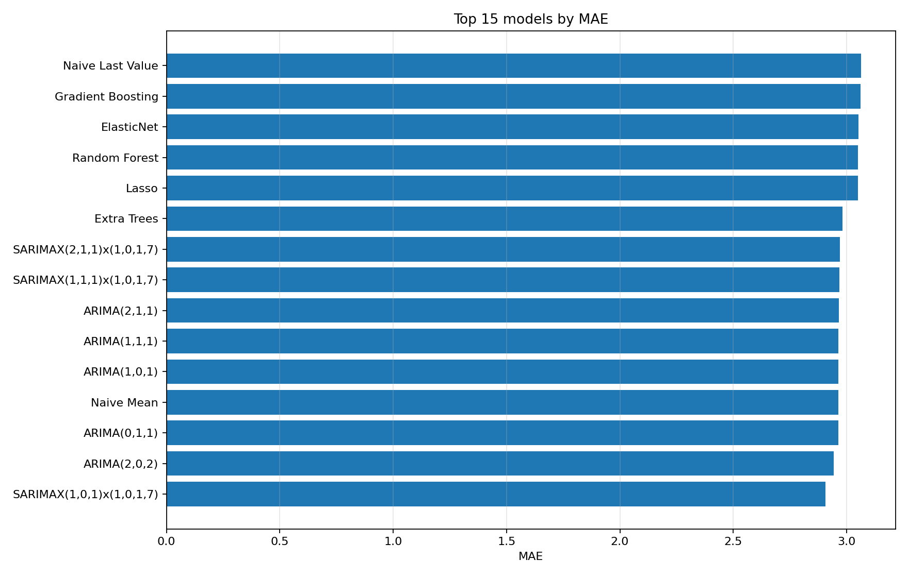
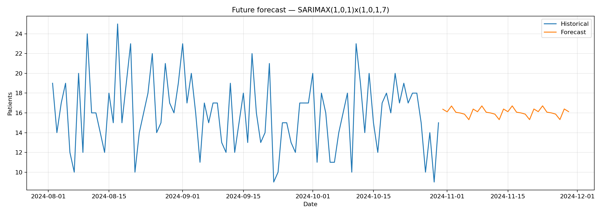

# Emergency Department Patient Volume Forecasting

Projet de prévision du volume journalier des admissions aux urgences à l’aide de modèles statistiques et de Machine Learning classique.

> **Version finale entraînée :** LSTM, TensorFlow, Holt-Winters et ETS ne sont pas utilisés. Le fichier patient brut n’est pas inclus dans le dépôt. Les résultats publics proviennent uniquement d’une série journalière agrégée.



## Objectif

Anticiper le nombre quotidien d’admissions afin d’appuyer la planification des effectifs, des lits et des ressources opérationnelles. Le projet compare des baselines simples, ARIMA/SARIMAX et plusieurs modèles de régression dans une validation strictement chronologique.

## Dataset utilisé pour l’exécution finale

Le fichier fourni contient :

- **9 216 admissions** et 12 colonnes ;
- **9 216 identifiants patients distincts** ;
- une période allant du **1er avril 2023 au 30 octobre 2024** ;
- **579 jours** après agrégation quotidienne ;
- aucun doublon de ligne et aucune date invalide détectés.

Le fichier brut contient des identifiants et des noms. Il est donc volontairement absent du dépôt. Le pipeline conserve uniquement deux colonnes : `Date` et `patients`.

## Modèles évalués

- **Baselines :** moyenne historique, dernière valeur, retard saisonnier de 7 jours et moyenne mobile de 7 jours.
- **Statistiques :** ARIMA et SARIMAX avec saisonnalité hebdomadaire.
- **Machine Learning :** Linear Regression, Ridge, Lasso, ElasticNet, KNN, SVR, Random Forest, Extra Trees, Gradient Boosting, HistGradientBoosting et MLP Regressor.
- **Optionnels :** XGBoost, LightGBM et CatBoost, lorsqu’ils sont installés.

## Résultats vérifiés

L’exécution finale utilise 551 observations exploitables après création des retards et fenêtres mobiles :

- 440 observations d’entraînement ;
- 111 observations de test, placées à la fin de la série ;
- 40 variables explicatives ;
- aucune permutation aléatoire de la chronologie.

| Modèle | MAE | RMSE | R² | Précision ±2 patients |
|---|---:|---:|---:|---:|
| SARIMAX (1,0,1) × (1,0,1,7) | **2,908** | **3,717** | **0,028** | 43,2 % |
| ARIMA (2,0,2) | 2,942 | 3,755 | 0,008 | 43,2 % |
| Moyenne naïve | 2,963 | 3,779 | -0,005 | **44,1 %** |
| Extra Trees | 2,982 | 3,788 | -0,010 | 41,4 % |
| Random Forest | 3,050 | 3,825 | -0,030 | 39,6 % |

Le SARIMAX réduit la MAE d’environ **1,9 %** par rapport à la moyenne naïve. Le gain est modeste et le R² reste proche de zéro : la variabilité quotidienne demeure difficile à expliquer avec les variables disponibles. Le projet ne présente donc pas ces résultats comme une précision clinique élevée.

Les sorties complètes se trouvent dans [`results/final/`](results/final/) et les graphiques dans [`figures/final/`](figures/final/).

## Prévision finale

Le meilleur modèle est réentraîné sur toute la série, puis utilisé pour une prévision de 30 jours, du **31 octobre au 29 novembre 2024**. La prévision moyenne est d’environ **16,08 admissions par jour**, avec des valeurs comprises entre **15,31 et 16,71**.



## Structure du dépôt

```text
er-patient-volume-forecasting/
├── notebooks/
│   └── ER_Patient_Volume_Forecasting.ipynb
├── src/
│   ├── data.py
│   ├── features.py
│   ├── metrics.py
│   ├── models.py
│   ├── statistical.py
│   ├── experiment.py
│   └── plots.py
├── data/
│   ├── raw/          # données privées, ignorées par Git
│   ├── processed/    # agrégation locale, ignorée par Git
│   └── demo/         # données synthétiques publiques
├── results/final/    # métriques et prévisions validées
├── figures/final/    # graphiques validés
├── docs/
├── tests/
├── scripts/
├── prepare_data.py
├── run_experiment.py
└── requirements.txt
```

## Installation

### Windows

```cmd
scripts\setup_windows.bat
```

### Installation manuelle

```bash
python -m venv .venv
# Windows
.venv\Scripts\activate
# Linux/macOS
source .venv/bin/activate

python -m pip install --upgrade pip
pip install -r requirements.txt
```

Les modèles optionnels sont séparés :

```bash
pip install -r requirements-optional.txt
```

## Préparation sécurisée des données

Placez le fichier brut hors du dépôt, puis exécutez :

```bash
python prepare_data.py --input "chemin/vers/Hospital ER_Data.csv"
```

Cette commande crée localement :

```text
data/processed/daily_er_volume.csv
```

Le fichier produit contient uniquement :

```csv
Date,patients
2023-04-01,19
2023-04-02,13
```

## Reproduire l’entraînement

```bash
python run_experiment.py \
  --data data/processed/daily_er_volume.csv \
  --output results/latest \
  --figures figures/latest
```

Exécution rapide :

```bash
python run_experiment.py --data data/processed/daily_er_volume.csv --fast
```

## Démonstration sans données privées

```bash
python scripts/generate_demo_data.py
python run_experiment.py \
  --data data/demo/daily_er_volume_demo.csv \
  --fast \
  --output results/demo \
  --figures figures/demo
```

Les données de démonstration sont artificielles et ne doivent pas être présentées comme des résultats hospitaliers réels.

## Tests

```bash
pytest -q
```

## Documentation

- [`docs/METHODOLOGY.md`](docs/METHODOLOGY.md) : méthode complète ;
- [`docs/RESULTS.md`](docs/RESULTS.md) : résultats et interprétation ;
- [`docs/DATASET_AUDIT.md`](docs/DATASET_AUDIT.md) : audit du fichier fourni ;
- [`docs/DATA_PRIVACY.md`](docs/DATA_PRIVACY.md) : règles de confidentialité ;
- [`docs/GITHUB_PUBLICATION.md`](docs/GITHUB_PUBLICATION.md) : publication du dépôt.

## Limites

- Le meilleur modèle améliore faiblement la baseline moyenne.
- Le R² proche de zéro indique une faible explication de la variance quotidienne.
- La prévision s’appuie principalement sur l’historique et le calendrier ; elle ne comprend pas la météo réelle, les épidémies, les événements locaux ou les capacités hospitalières.
- Les prévisions sont destinées à l’aide à la planification, pas à la prise de décision médicale individuelle.
- La licence de redistribution du dataset brut doit être vérifiée auprès de sa source avant toute publication.

## Auteur

**Kaouthar El Attaoui** — Master Science et Ingénierie des Données, Université Mohammed V de Rabat.

## Licence

Le code est publié sous licence MIT. Les données tierces conservent leur propre licence et ne sont pas automatiquement couvertes par celle du dépôt.
